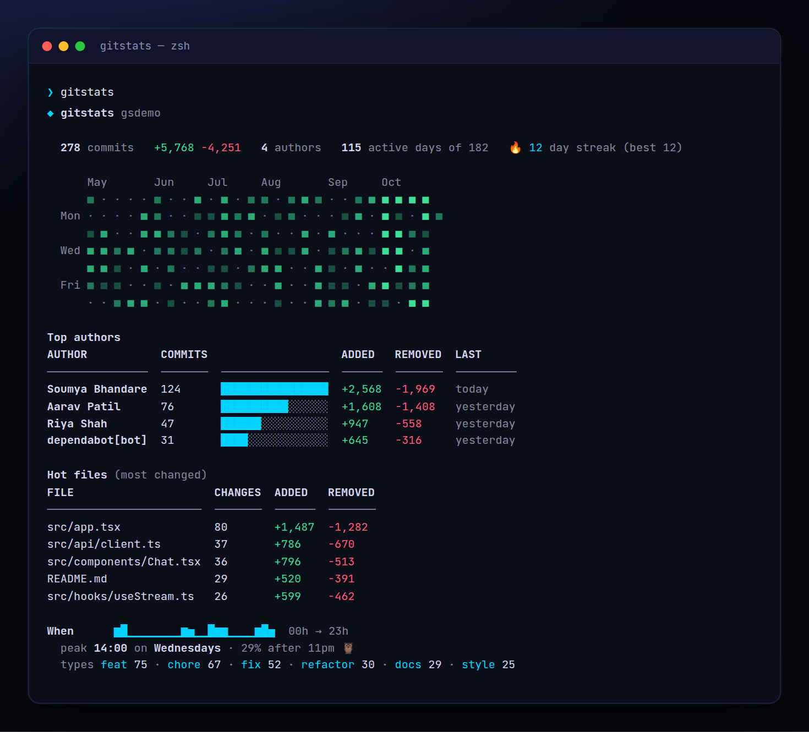

<!-- ═════════════ HEADER ═════════════ -->
<p align="center">
  
</p>

<p align="center">
  
</p>

<p align="center">
  <a href="https://github.com/krishyaa06/prism-git-stats/actions/workflows/ci.yml"></a>
  
  
  <a href="LICENSE"></a>
</p>

<p align="center">
  
</p>


## ⚡ Overview

**Prism Git Stats** (`gitstats`) reads `git log --numstat` and renders a one-screen dashboard of your project: a GitHub-style contribution heatmap, current and best streak, top authors with lines added / removed, the files that change the most (your hotspots), when you actually commit, and a breakdown of conventional-commit types. Filter by date, author or folder, or get everything as JSON.

## ✨ Features

- **Contribution heatmap** (truecolor) for the last 4–52 weeks + current / best **streak**
- **Top authors** with commits, lines added / removed and last activity (same email = same person)
- **Hot files**: most frequently changed files — great for spotting fragile code
- **When** you commit: 24-hour sparkline, peak hour + weekday, night-owl percentage
- Conventional-commit **types** breakdown (`feat`, `fix`, `chore`…)
- `--since`, `--until`, `--author`, `--path`, `--all`, `--json`. Zero dependencies, just git

## 🚀 Quick Start

```bash
# run without installing
npx github:krishyaa06/prism-git-stats 

# or install globally
npm install -g github:krishyaa06/prism-git-stats
gitstats --since "1 month ago"
```

Requires Node.js 18.17+. No dependencies.

## 🛠️ Usage

```text
gitstats [dir] [options]

  -s, --since <when>     e.g. "3 months ago", 2026-01-01
  -u, --until <when>
  -a, --author <name>    only this author
  -p, --path <path>      only this folder / file
      --all              all branches
  -n, --top <n>          rows in tables (default 5)
  -w, --weeks <n>        heatmap width (default 26)
      --json             machine-readable output
```

### Examples

```bash
gitstats --since "1 month ago"      # this month
gitstats -p src/components -n 10     # hotspots in one folder
gitstats --author soumya --json      # your own numbers, for a script
```

Want to try it on a busy repo? `sh examples/make-demo-repo.sh /tmp/demo && gitstats /tmp/demo` builds a fake 6-month history with 4 authors.

## 📁 Project Structure

```
prism-git-stats/
├── assets/
│   ├── logo.png
│   └── logo.svg
├── bin/
│   └── gitstats.js   # CLI entry
├── examples/
│   └── make-demo-repo.sh   # fake history generator
├── src/
│   ├── index.js   # git log parser + stats + heatmap
│   └── ui.js   # colours, tables
├── test/
│   └── gitstats.test.js
├── .gitignore
├── LICENSE
└── package.json
```

## 🧪 Tests

```bash
npm test
```

Tests use the built-in `node:test` runner, so there is nothing to install. CI runs them on Node 20 and 22.

## 🤝 Contributing

1. Fork the repo and create a branch: `git checkout -b feature/my-idea`
2. Make your change and add a test in `test/`
3. Run `npm test` and open a Pull Request

## 🔷 Part of Prism Protocol

Prism Git Stats is one of the open-source tools built by [Prism Protocol](https://dc.gg/prismprotocol), a tech community where young builders learn, ship and compete together.

## 👤 Author

<table>
  <tr>
    <td align="center">
      <a href="https://github.com/krishyaa06"><br><b>Soumya Bhandare</b></a><br>
      <sub>Founder @ Prism Protocol</sub>
    </td>
    <td>
      <a href="https://dc.gg/prismprotocol"></a><br>
      <a href="https://instagram.com/prism_protocol_"></a><br>
      <a href="https://x.com/krishyaa06"></a>
    </td>
  </tr>
</table>

## 📄 License

Released under the [MIT License](LICENSE).

<p align="center">
  <b>If you like this project, consider giving it a ⭐</b><br>
  <sub>"Build. Create. Compete." · Made with ⚡ by Prism Protocol</sub>
</p>


